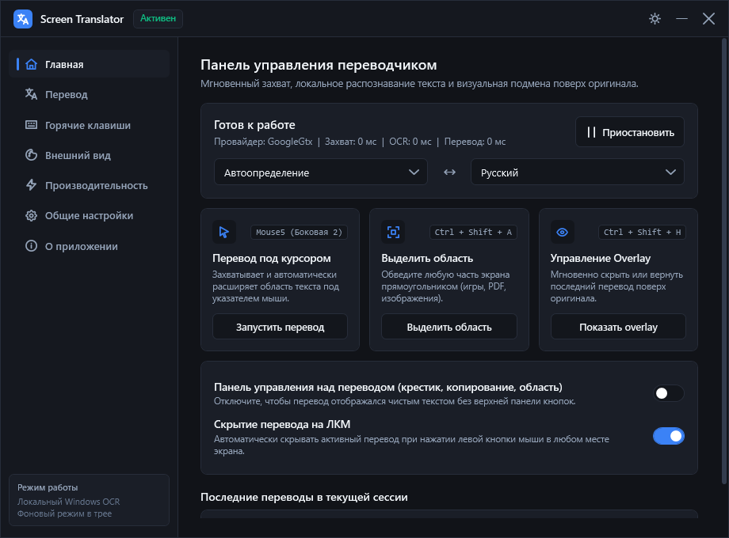
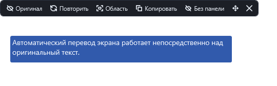
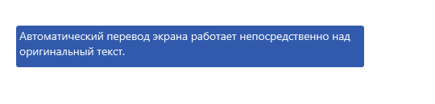
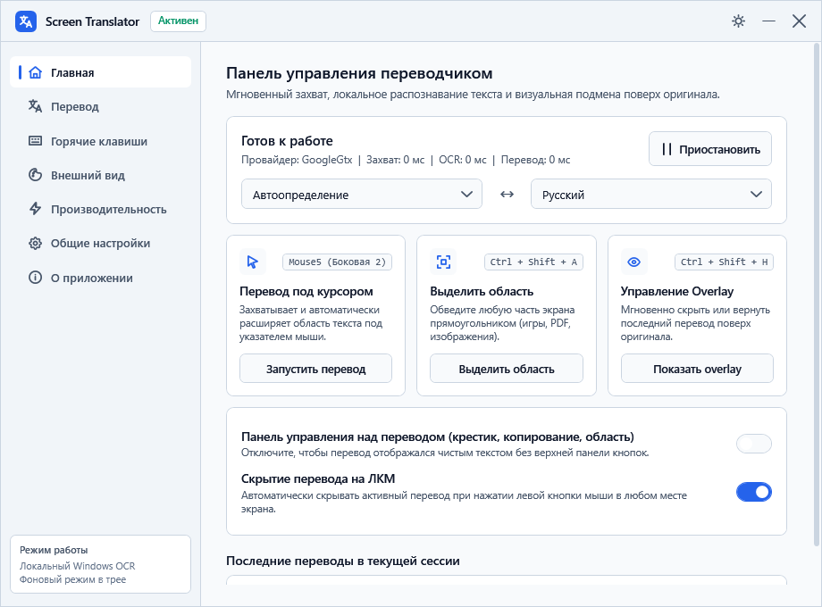
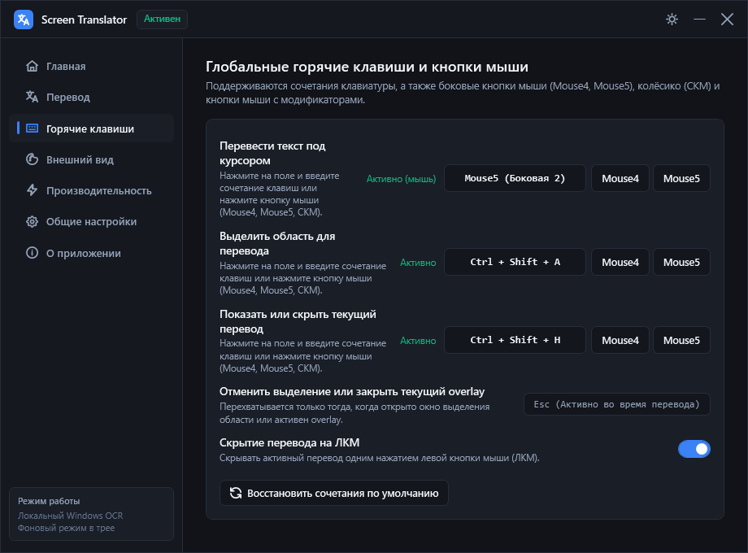
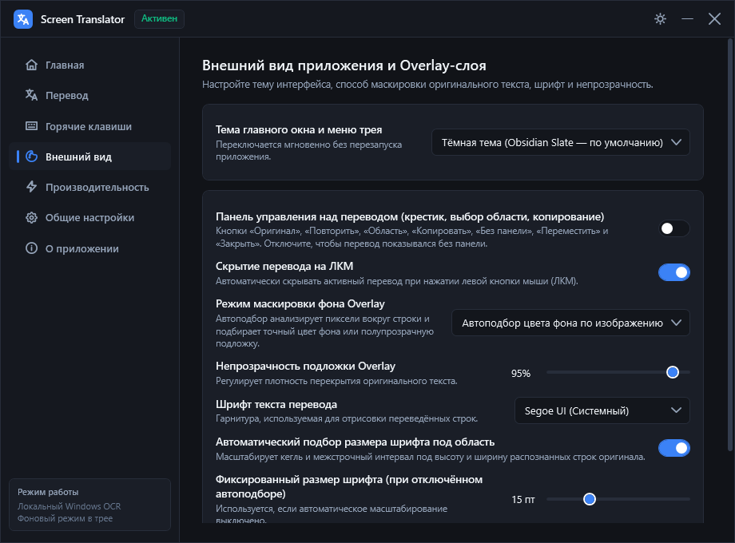
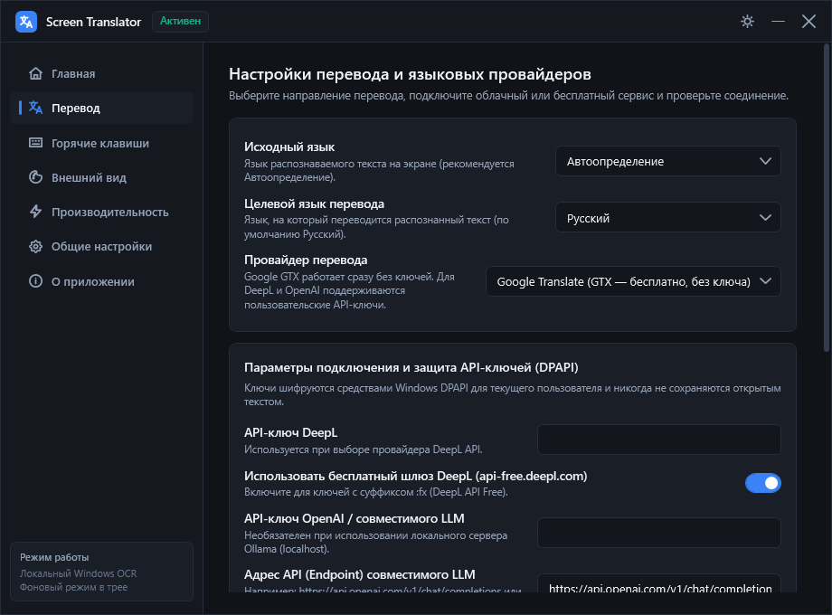
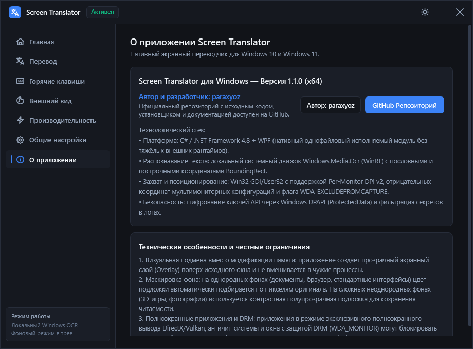
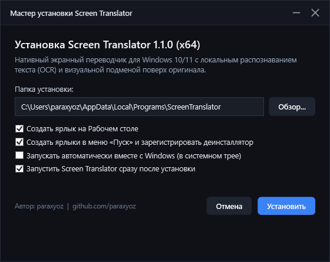
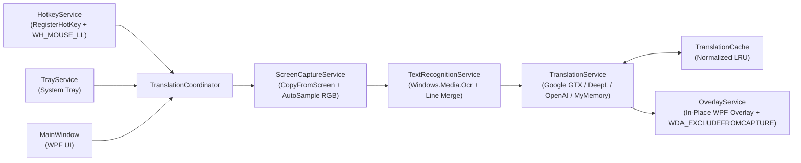

<div align="center">

# Screen Translator для Windows 10 / 11

**Нативный экранный переводчик с локальным распознаванием текста (Windows OCR) и визуальной подменой перевода непосредственно поверх оригинала**

[](https://github.com/paraxyoz/screen-translator/releases/latest)
[](https://github.com/paraxyoz/screen-translator/releases/latest/download/ScreenTranslatorSetup.exe)
[](https://github.com/paraxyoz/screen-translator/releases/latest/download/ScreenTranslator.exe)
[-0078D6?style=for-the-badge&logo=windows)](https://github.com/paraxyoz/screen-translator)
[](https://github.com/paraxyoz)

<br />

[**Скачать установщик (Releases)**](https://github.com/paraxyoz/screen-translator/releases/latest) •
[**Возможности**](#-ключевые-возможности) •
[**Скриншоты интерфейса**](#-галерея-интерфейса) •
[**Инструкция по использованию**](#-инструкция-по-установке-и-использованию) •
[**Горячие клавиши и мышь**](#-горячие-клавиши-и-кнопки-мыши) •
[**Сборка из исходников**](#-сборка-из-исходного-кода)

---



</div>

## О проекте

**Screen Translator** — легковесное нативное десктопное приложение для Windows 10 и Windows 11, разработанное [@paraxyoz](https://github.com/paraxyoz). Программа позволяет переводить любой текст в играх, PDF-документах, браузерах, мессенджерах, графических редакторах и системных окнах **без переключения в отдельное окно**: перевод отображается **непосредственно поверх оригинального текста** в том же месте экрана с автоматическим подбором цвета фона.

---

## Быстрая загрузка

| Пакет | Назначение | Размер | Ссылка на скачивание |
| :--- | :--- | :---: | :---: |
| **`ScreenTranslatorSetup.exe`** | **Полноценный установщик Windows** (создаёт ярлыки на Рабочем столе и в меню «Пуск», регистрирует деинсталлятор в «Установленных приложениях» Windows и настраивает автозапуск) | ~243 КБ | [**Скачать `ScreenTranslatorSetup.exe`**](https://github.com/paraxyoz/screen-translator/releases/latest/download/ScreenTranslatorSetup.exe) · [Из папки `dist/`](dist/ScreenTranslatorSetup.exe) |
| **`ScreenTranslator.exe`** | **Portable-версия** (единый исполняемый файл без установки и внешних зависимостей) | ~223 КБ | [**Скачать `ScreenTranslator.exe`**](https://github.com/paraxyoz/screen-translator/releases/latest/download/ScreenTranslator.exe) · [Из папки `dist/`](dist/ScreenTranslator.exe) |

---

## Ключевые возможности

- **Перевод на месте оригинала (In-Place Overlay)**:
  - Пословное и построчное определение координат текста (`BoundingRect`) с отрисовкой перевода поверх исходных строк.
  - **Умный автоподбор цвета фона (`AutoSample`)**: алгоритм анализирует цвет периметра вокруг букв, отфильтровывает контрастные глифы и сохраняет реальный оттенок фона (синий фон остаётся синим, тёмный — тёмным, светлый — светлым).
  - **Склейка коллинеарных фрагментов строки**: если OCR разбивает соседние слова на одной горизонтальной линии, они автоматически объединяются в единую строку без наложений.
- **Гибкое управление Overlay-слоем**:
  - Верхняя микро-панель действий (**«Оригинал»**, **«Повторить»**, **«Область»**, **«Копировать»**, **«Без панели»**, **«Переместить»**, **«Закрыть»**).
  - Возможность полностью отключить верхнюю панель, чтобы отображался **только чистый перевод**.
  - Опция **«Скрытие перевода на ЛКМ»** — закрытие активного перевода одним кликом левой кнопки мыши в любом месте экрана.
- **Поддержка клавиатуры и боковых кнопок мыши**:
  - Назначение глобальных биндов не только на клавиатуру (`Ctrl + Shift + T`), но и на **боковые кнопки мыши (`Mouse4`, `Mouse5`)**, колёсико (`СКМ`) и кнопки мыши с модификаторами через низкоуровневый системный хук `WH_MOUSE_LL`.
- **Локальный OCR без отправки скриншотов в облако**:
  - Используется встроенный системный движок `Windows.Media.Ocr` (WinRT) с автоматическим 2x бикубическим апскейлингом мелких шрифтов.
- **Защита от самозахвата (`WDA_EXCLUDEFROMCAPTURE`)**:
  - При повторном переводе того же места окно оверлея автоматически исключается из экранного захвата без мигания.
- **4 провайдера перевода + защита ключей DPAPI**:
  - **Google Translate (GTX)** (работает сразу бесплатно без ключа), **MyMemory API**, **DeepL API (Free / Pro)** и **OpenAI / совместимый LLM (GPT-4o-mini, DeepSeek, локальный Ollama)**. Все API-ключи шифруются через `Windows DPAPI`.

---

## Галерея интерфейса

### 1. Визуальная подмена текста поверх оригинала (с панелью и без панели)

| Оверлей с панелью управления | Чистый перевод без панели (`ShowOverlayToolbar = false`) |
| :---: | :---: |
|  |  |

### 2. Главное окно (Тёмная и Светлая темы)

| Тёмная тема (Obsidian Slate) | Светлая тема (Paper & Slate) |
| :---: | :---: |
|  |  |

### 3. Горячие клавиши (включая `Mouse4` / `Mouse5`) и настройки Внешнего вида

| Глобальные клавиши и бинды на мышь | Внешний вид и живой предпросмотр Overlay |
| :---: | :---: |
|  |  |

### 4. Провайдеры перевода, раздел «О приложении» и Установщик

| Провайдеры перевода и шифрование DPAPI | О приложении (Автор: `paraxyoz`) |
| :---: | :---: |
|  |  |

<div align="center">

#### Мастер установки `ScreenTranslatorSetup.exe`


</div>

---

## Инструкция по установке и использованию

### Шаг 1. Установка программы
1. Скачайте [**`ScreenTranslatorSetup.exe`**](https://github.com/paraxyoz/screen-translator/releases/latest/download/ScreenTranslatorSetup.exe) из раздела [Releases](https://github.com/paraxyoz/screen-translator/releases/latest).
2. Запустите установщик, выберите папку установки (по умолчанию `%LocalAppData%\Programs\ScreenTranslator`), отметьте создание ярлыков на Рабочем столе / в меню «Пуск» и нажмите **«Установить»**.
   - Для тихой автоматической установки из командной строки поддерживается ключ:
     ```powershell
     .\ScreenTranslatorSetup.exe --silent
     ```
   - Для удаления программы используйте ярлык **«Удалить Screen Translator»** в меню «Пуск», стандартный раздел **«Установленные приложения» Windows** или команду `Uninstall.exe --uninstall`.

### Шаг 2. Три режима перевода

1. **Режим A — Перевод текста под курсором** (`Ctrl + Shift + T` или `Mouse4`/`Mouse5`):
   - Наведите курсор мыши на любой текст на экране и нажмите горячую клавишу.
   - Приложение автоматически захватит зону вокруг курсора (и расширит её, если строка или абзац шире стартовой рамки), распознает текст и отобразит перевод прямо поверх оригинала.
2. **Режим B — Перевод выделенной области** (`Ctrl + Shift + A`):
   - Нажмите горячую клавишу и выделите прямоугольную область экрана зажатой левой кнопкой мыши.
   - Сразу после отпускания кнопки мыши весь текст внутри выделенной рамки будет переведён и показан поверх оригинала.
3. **Режим C — Временный перевод и управление оверлеем** (`Ctrl + Shift + H` / `ЛКМ` / `Esc`):
   - Нажмите **ЛКМ** в любом месте экрана (при включённой опции *«Скрытие перевода на ЛКМ»*) или клавишу **`Esc`**, чтобы мгновенно убрать перевод и продолжить работу.
   - Нажмите `Ctrl + Shift + H`, чтобы повторно показать или скрыть последний перевод.
   - Нажмите **«Без панели»** на панели над переводом (или отключите переключатель на главной странице), если хотите видеть только переведённый текст без кнопок.

---

## Горячие клавиши и кнопки мыши

В разделе **«Горячие клавиши»** можно назначить любое действие на клавиатуру или мышь:

| Действие | По умолчанию | Поддерживаемые бинды мыши |
| :--- | :---: | :--- |
| **Перевести текст под курсором** | `Ctrl + Shift + T` | `Mouse4 (Боковая 1)`, `Mouse5 (Боковая 2)`, `СКМ`, `Ctrl/Shift/Alt + ЛКМ/ПКМ` |
| **Выделить область для перевода** | `Ctrl + Shift + A` | `Mouse4 (Боковая 1)`, `Mouse5 (Боковая 2)`, `СКМ`, `Ctrl/Shift/Alt + ЛКМ/ПКМ` |
| **Показать / скрыть текущий перевод** | `Ctrl + Shift + H` | `Mouse4 (Боковая 1)`, `Mouse5 (Боковая 2)`, `СКМ`, `Ctrl/Shift/Alt + ЛКМ/ПКМ` |
| **Скрыть активный перевод / Отмена** | `ЛКМ` / `Esc` | Настраивается переключателем «Скрытие перевода на ЛКМ» |

---

## Архитектура проекта



- [`src/ScreenTranslator/Services/ScreenCaptureService.cs`](src/ScreenTranslator/Services/ScreenCaptureService.cs) — захват экрана с учётом Per-Monitor DPI v2 и фильтрация глифов при определении цвета фона (`SampleRegionStyle`).
- [`src/ScreenTranslator/Services/TextRecognitionService.cs`](src/ScreenTranslator/Services/TextRecognitionService.cs) — локальное распознавание через `Windows.Media.Ocr`, адаптивное расширение области под курсором и объединение фрагментов одной строки (`MergeCollinearHorizontalLines`).
- [`src/ScreenTranslator/Services/TranslationService.cs`](src/ScreenTranslator/Services/TranslationService.cs) — клиенты Google GTX, MyMemory, DeepL и OpenAI-совместимых API с пропорциональным сопоставлением строк.
- [`src/ScreenTranslator/Services/OverlayService.cs`](src/ScreenTranslator/Services/OverlayService.cs) — прозрачное Topmost-окно с подбором фона, панелью быстрых действий, защитой `WDA_EXCLUDEFROMCAPTURE` и скрытием по ЛКМ.
- [`src/ScreenTranslator/Services/HotkeyService.cs`](src/ScreenTranslator/Services/HotkeyService.cs) — глобальные сочетания клавиш (`RegisterHotKey`) и низкоуровневый хук мыши (`WH_MOUSE_LL`).
- [`installer/ScreenTranslatorSetup.cs`](installer/ScreenTranslatorSetup.cs) — графический и консольный установщик/деинсталлятор Windows.

---

## Сборка из исходного кода

Проект компилируется стандартным `MSBuild` (.NET Framework 4.8 входит в состав Windows 10/11 по умолчанию):

```powershell
# Сборка приложения, прогон всех 17 автотестов и упаковка установщика ScreenTranslatorSetup.exe
powershell -ExecutionPolicy Bypass -File .\build.ps1

# Запуск E2E самопроверки
Start-Process -FilePath ".\bin\Release\ScreenTranslator.exe" -ArgumentList "--self-test" -Wait
```

---

## Автор

Разработано **[paraxyoz](https://github.com/paraxyoz)**.
- GitHub: [@paraxyoz](https://github.com/paraxyoz)
- Репозиторий: [github.com/paraxyoz/screen-translator](https://github.com/paraxyoz/screen-translator)
